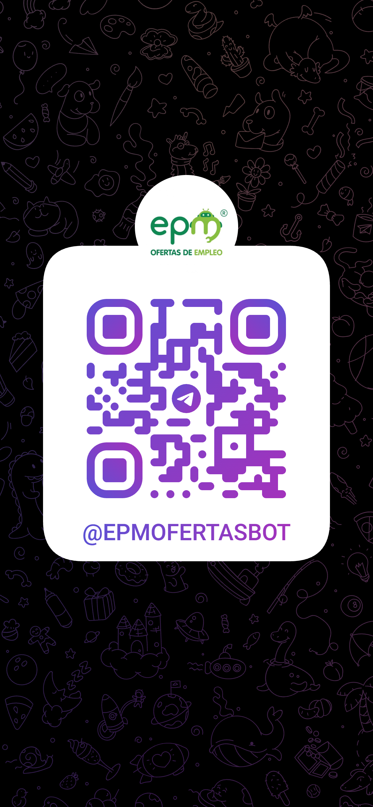
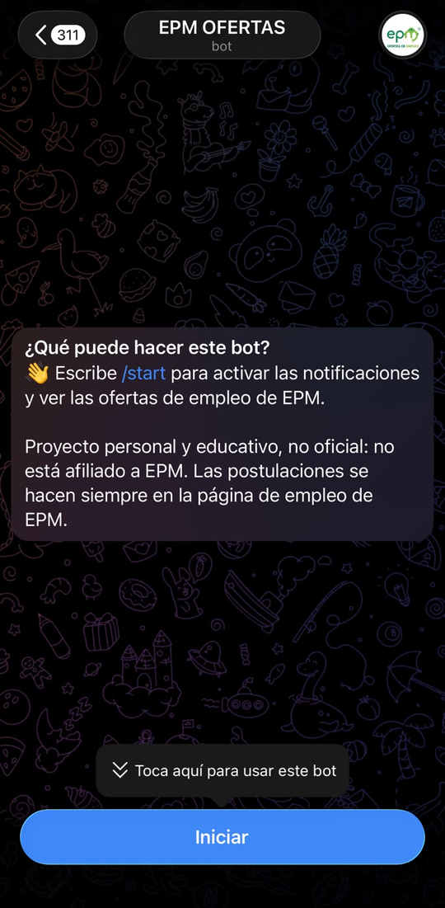
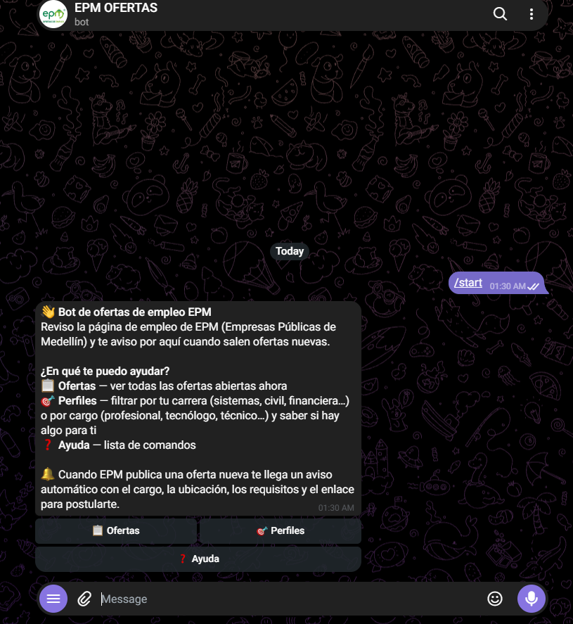
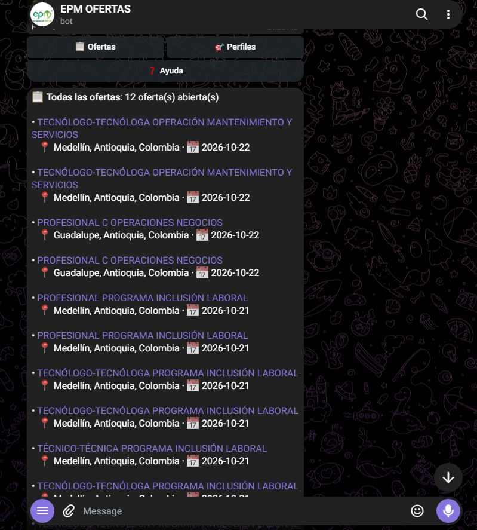
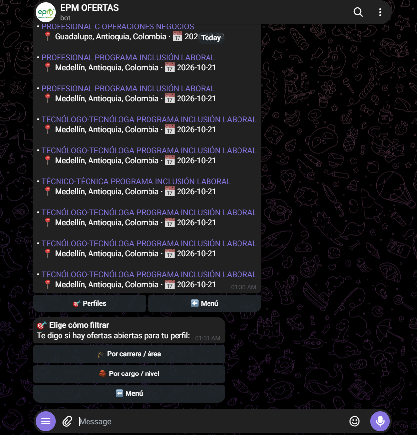
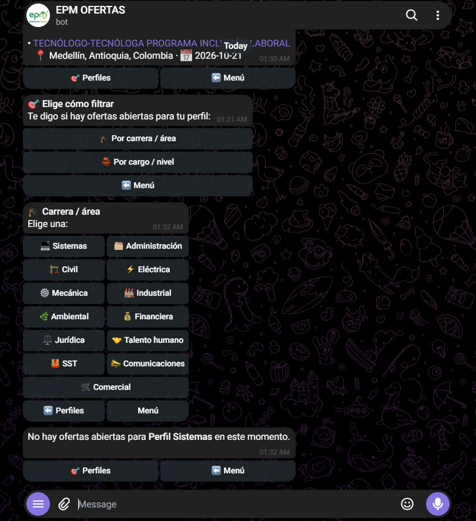
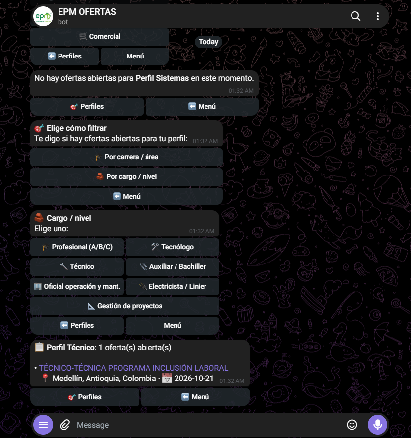
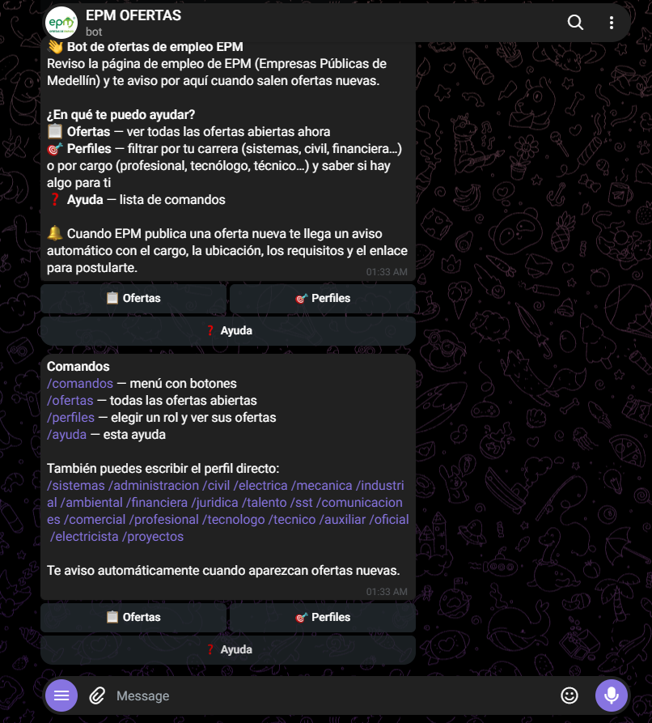

# Notificador de ofertas EPM → Telegram

Consulta la API REST pública de Oracle HCM que usa la página de empleo de EPM y avisa por Telegram de las ofertas nuevas. Node.js 20+, sin dependencias.

## Pruébalo

<p align="center">
  <a href="https://t.me/epmofertasbot"></a>
  <br>
  <b><a href="https://t.me/epmofertasbot">Abrir @epmofertasbot en Telegram</a></b>
  <br>
  <sub>Escanea el QR con la cámara de tu celular o toca el enlace</sub>
</p>

1. Pulsa **Iniciar / Start**.
2. Toca **🎯 Perfiles** para ver si hay ofertas de tu carrera o cargo.
3. Toca **🔔 Suscribirme** y elige *todas las ofertas* o solo tus perfiles: te avisará cuando EPM publique algo nuevo.

> El bot solo guarda el id de tu chat para enviarte los avisos. Puedes cancelarlos cuando quieras desde el mismo menú.
> ⚠️ Proyecto personal y educativo, **no oficial ni afiliado a EPM** (ver [Aviso legal](#aviso-legal)). Las ofertas se postulan siempre en la página de empleo de EPM.
> El bot responde mientras la instancia que lo ejecuta esté encendida.

## Aviso legal

- Este es un **proyecto personal, educativo y sin fines de lucro**, hecho para mantenerme al tanto de las ofertas laborales de EPM.
- **No está afiliado, patrocinado ni respaldado por EPM (Empresas Públicas de Medellín).** No tengo ningún derecho sobre EPM ni sobre su nombre, marca o logotipo, que pertenecen a sus titulares. Las menciones a EPM son únicamente para indicar de dónde proviene la información.
- No copia ni redistribuye el sitio de EPM: consulta la misma API pública que usa su página de empleo y solo reenvía datos básicos de cada oferta (título, ubicación, fecha, un resumen breve y requisitos) con **enlace a la fuente oficial**. Toda postulación se hace en la página oficial de EPM.
- Sin garantías: la información puede estar desactualizada o incompleta. Verifica siempre en el sitio oficial. Desconfía de cualquier oferta que te pida dinero.
- Si eres titular de derechos y quieres que algo se modifique o se retire, abre un *issue* en este repositorio y se atenderá.

## Cómo se ve

Al abrir el bot por primera vez, Telegram muestra qué hace y el botón **Iniciar**. Después, `/start` o `/comandos` abre un menú con botones.

| 1. Primer ingreso | 2. Menú de inicio | 3. Todas las ofertas | 4. Cómo filtrar |
|:---:|:---:|:---:|:---:|
|  |  |  |  |

| 5. Por carrera / área | 6. Por cargo / nivel | 7. Ayuda |
|:---:|:---:|:---:|
|  |  |  |

## Cómo funciona
- `GET /hcmRestApi/resources/latest/recruitingCEJobRequisitions` (finder `findReqs`, con paginación) lista las ofertas; `recruitingCEJobRequisitionDetails` da el detalle.
- Compara con los IDs de `seen.json`. **Primera ejecución**: guarda las existentes sin notificar y envía "Notificador EPM activo".
- Todas las ofertas del listado se marcan como vistas, también las que no pasan `KEYWORDS`.
- El estado se guarda (de forma atómica) después de cada oferta enviada. Si algo falla a mitad, la oferta fallida se reintenta en la siguiente ejecución y las ya enviadas no se repiten.
- Los errores se imprimen y se mandan a Telegram (sin fallar si Telegram también cae). Reintentos con backoff para red/5xx/429.

## 1. Crear el bot
1. En Telegram habla con **@BotFather** → `/newbot` → copia el token.
2. `cp .env.example .env` y pon `TELEGRAM_BOT_TOKEN`.

## 2. Obtener el chat id
- **Chat personal**: escríbele cualquier mensaje a tu bot y ejecuta `node epm-notifier.mjs --get-chat-id`. Imprime `TELEGRAM_CHAT_ID=...` (nunca el token).
- **Canal**: añade el bot como administrador, publica algo y ejecuta el mismo comando (el id empieza por `-100`).

Ponlo en `.env`.

## 3. Ejecutar
```bash
node epm-notifier.mjs             # ejecución normal
node epm-notifier.mjs --dry-run   # imprime en consola, no envía; usa seen.json.dry
```
Configuración (`.env` o variables de entorno): `TELEGRAM_BOT_TOKEN`, `TELEGRAM_CHAT_ID`, `KEYWORDS` (opcional, p. ej. `ingeniero,sistemas`; ignora tildes y mayúsculas, filtra por título/ubicación), `STATE_FILE` (por defecto `./seen.json`).

### Perfiles (filtro por carrera)
```bash
node epm-notifier.mjs --perfil sistemas   # o PERFIL=sistemas en .env / variable de entorno
```
Perfiles disponibles: `sistemas`, `administracion`, `civil`, `electrica`, `mecanica`, `industrial`, `ambiental`, `financiera`, `juridica`, `talento`, `sst`, `comunicaciones`, `comercial` y `tecnico` (técnicos/tecnólogos/operarios). Se pueden combinar: `--perfil sistemas,civil`. Cada uno incluye términos afines (p. ej. `sistemas`: ingeniería de sistemas/informática/software, TI, desarrollador, datos, ciberseguridad, nube, telemática…) y los busca como palabra completa en título y descripción. Se combina con `KEYWORDS` (basta que cumpla una). Las ofertas que no pasan el filtro se marcan igualmente como vistas. Para añadir perfiles o términos, edita `PROFILES` en `epm-notifier.mjs`. En cron añade `--perfil sistemas` al comando; en K3s usa `PERFIL: sistemas` en el Secret.

### Usuarios, suscripciones y grupos
Hay dos tipos de chats:

- **Público (cualquiera):** puede consultar (`/ofertas`, `/perfiles`, `/sistemas`…) y **suscribirse** con `/suscribir` (botón 🔔). Cada chat elige *todas las ofertas* o uno o varios perfiles y solo recibe lo suyo. Las suscripciones se guardan en `seen.json.subs` (solo el id del chat y los perfiles elegidos); si alguien bloquea el bot, su suscripción se elimina sola. Límite de suscriptores: `MAX_SUBS` (500 por defecto).
- **Administrador y chats autorizados:** `TELEGRAM_CHAT_ID` admite varios ids separados por coma y **el primero es el administrador** (tú). Los chats autorizados reciben todas las ofertas nuevas (respetando `--perfil`/`KEYWORDS` si los usas) y los avisos de error solo te llegan a ti.

**Grupo:** añade el bot al grupo. Cualquier miembro puede consultar y suscribir *el grupo* con los botones. Si como administrador escribes `/activar` en el grupo, queda autorizado (recibe todo); `/desactivar` lo quita.

**Administración** (solo tú, en privado con el bot): `/agregar <id>`, `/quitar <id>` y `/chats` (lista los autorizados y cuenta los suscriptores). Los autorizados añadidos así se guardan en `seen.json.chats`. En K3s estos archivos van en el PVC.

### Comandos de Telegram
Escríbele al bot: `/comandos` (menú), `/ofertas` (todas), `/perfiles`, `/suscribir`, `/sistemas` (ofertas abiertas de un perfil), `/ayuda`.
- **Con cron/CronJob** los comandos se atienden en cada ejecución (hasta 20 min de retraso).
- **Respuesta inmediata**: `node epm-notifier.mjs --listen` queda activo, responde al instante y revisa ofertas nuevas cada 20 min (no uses cron a la vez). En K3s aplica `k8s/deployment.yaml` en lugar del CronJob.

Para probar con datos simulados: `EPM_MOCK_DIR=<carpeta>` lee `list-<offset>.json` y `detail-<id>.json` en vez de llamar a la API.

## 4a. Programar con cron (cada 20 min)
```cron
*/20 * * * * cd /ruta/a/EPM && /usr/bin/node epm-notifier.mjs >> notifier.log 2>&1
```

## 4b. K3s
```bash
docker build -t epm-notifier:latest .
# K3s usa containerd: importa la imagen (o súbela a tu registro y ajusta k8s/cronjob.yaml)
docker save epm-notifier:latest | sudo k3s ctr images import -

kubectl create secret generic epm-notifier \
  --from-literal=TELEGRAM_BOT_TOKEN='...' --from-literal=TELEGRAM_CHAT_ID='...'
# (o copia k8s/secret.example.yaml a k8s/secret.yaml, edítalo y aplícalo)
kubectl apply -f k8s/pvc.yaml -f k8s/cronjob.yaml

kubectl create job --from=cronjob/epm-notifier epm-test   # ejecución manual
kubectl logs job/epm-notifier-test
```
El PVC (`/data/seen.json`) evita que lleguen ofertas repetidas tras cada ejecución. Con `local-path` (RWO) el job debe correr en el mismo nodo; `concurrencyPolicy: Forbid` evita solapes.

## Seguridad
El token solo vive en `.env` / Secret. `.env` y `seen.json` están en `.gitignore` y los logs enmascaran el token.
