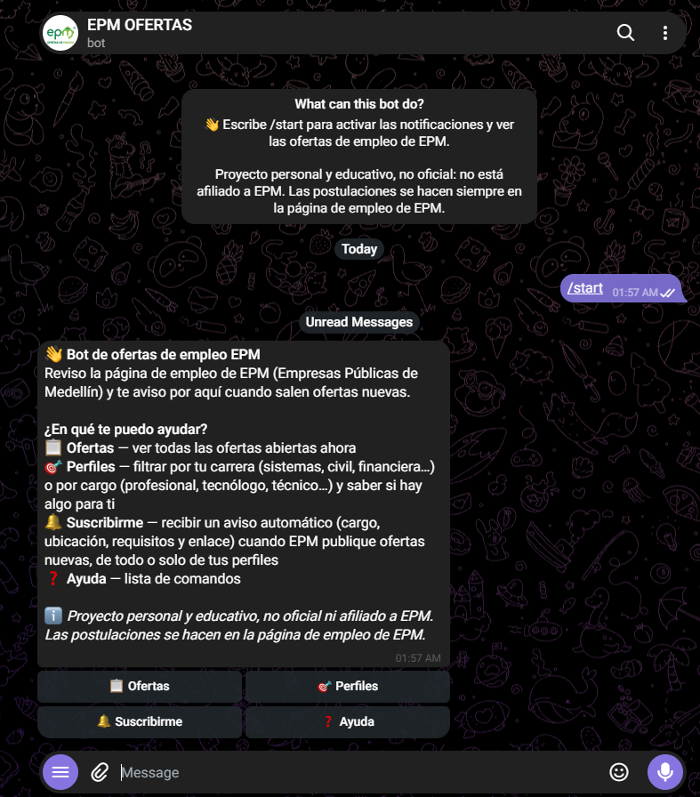
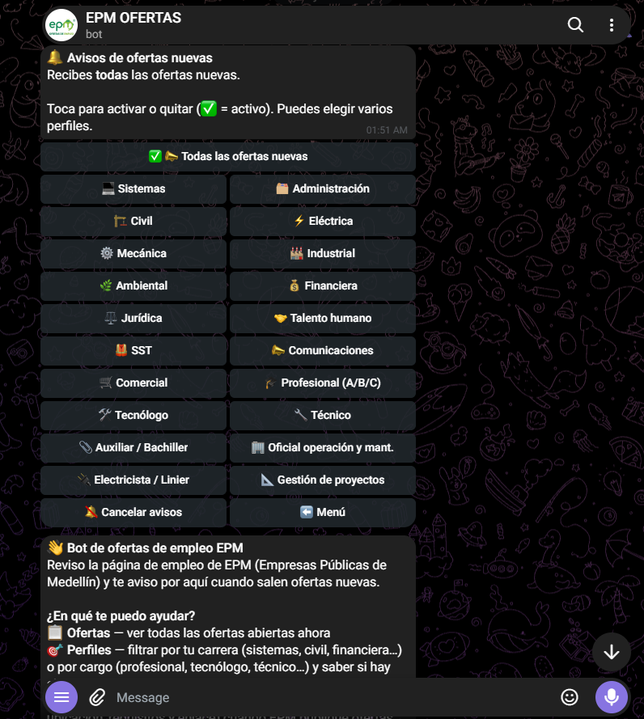

# Notificador de ofertas EPM → Telegram

Consulta la API REST pública de Oracle HCM que usa la página de empleo de EPM y avisa por Telegram de las ofertas nuevas. Corre en un **Cloudflare Worker con base de datos D1 y una cola**, en el plan gratuito: los comandos y botones responden en **décimas de segundo**, las ofertas nuevas se revisan cada 30 minutos, es **100 % gratis**, no usa servidores y no depende de ningún computador encendido.

## Pruébalo

<p align="center">
  <a href="https://t.me/epmofertasbot"></a>
  <br>
  <b><a href="https://t.me/epmofertasbot">Abrir @epmofertasbot en Telegram</a></b>
  <br>
  <sub>Escanea el QR con la cámara de tu celular o toca el enlace</sub>
</p>

1. Pulsa **Iniciar / Start**.
2. Toca **🎯 Perfiles** para ver si hay ofertas de tu carrera o cargo.
3. Toca **🔔 Suscribirme** y elige *todas las ofertas* o solo tus perfiles: te avisará cuando EPM publique algo nuevo.

> El bot solo guarda el id de tu chat para enviarte los avisos. Puedes cancelarlos cuando quieras desde el mismo menú.
> ⚠️ Proyecto personal y educativo, **no oficial ni afiliado a EPM** (ver [Aviso legal](#aviso-legal)). Las ofertas se postulan siempre en la página de empleo de EPM.
> ⚡ Los comandos y botones responden de inmediato y las ofertas nuevas se avisan en la siguiente revisión, cada ~30 minutos (ver [Cómo funciona](#cómo-funciona)).

## Aviso legal

- Este es un **proyecto personal, educativo y sin fines de lucro**, hecho para mantenerme al tanto de las ofertas laborales de EPM.
- **No está afiliado, patrocinado ni respaldado por EPM (Empresas Públicas de Medellín).** No tengo ningún derecho sobre EPM ni sobre su nombre, marca o logotipo, que pertenecen a sus titulares. Las menciones a EPM son únicamente para indicar de dónde proviene la información.
- No copia ni redistribuye el sitio de EPM: consulta la misma API pública que usa su página de empleo y solo reenvía datos básicos de cada oferta (título, ubicación, fecha, un resumen breve y requisitos) con **enlace a la fuente oficial**. Toda postulación se hace en la página oficial de EPM.
- Sin garantías: la información puede estar desactualizada o incompleta. Verifica siempre en el sitio oficial. Desconfía de cualquier oferta que te pida dinero.
- Si eres titular de derechos y quieres que algo se modifique o se retire, abre un *issue* en este repositorio y se atenderá.

## Cómo se ve

> 🔍 Toca o haz clic en cualquier imagen para verla en tamaño completo.

### 1. Primer ingreso

Al abrir el bot por primera vez, Telegram muestra qué hace y el botón **Iniciar**.

<p align="center">
  <a href="docs/screenshots/bienvenida.png"></a>
</p>

### 2. Menú de inicio

Con `/start` (o `/comandos`) el bot se presenta y ofrece un menú con botones: **Ofertas**, **Perfiles**, **Suscribirme** y **Ayuda**.

<p align="center">
  <a href="docs/screenshots/start1.png"></a>
</p>

### 3. Todas las ofertas

**📋 Ofertas** (o `/ofertas`) lista las ofertas abiertas con cargo, ubicación, fecha y enlace a la página oficial de EPM.

<p align="center">
  <a href="docs/screenshots/ofertas.png"></a>
</p>

### 4. Cómo filtrar

**🎯 Perfiles** (o `/perfiles`) permite filtrar por carrera o por cargo y responde si hay ofertas para ti.

<p align="center">
  <a href="docs/screenshots/perfiles.png"></a>
</p>

### 5. Por carrera / área

Sistemas, civil, eléctrica, financiera, jurídica, talento humano y más.

<p align="center">
  <a href="docs/screenshots/perfilesCarrera.png"></a>
</p>

### 6. Por cargo / nivel

Profesional, tecnólogo, técnico, oficial de operación y mantenimiento, electricista… Si hay coincidencias, las lista; si no, te lo dice.

<p align="center">
  <a href="docs/screenshots/perfilesCargo.png"></a>
</p>

### 7. Suscribirse a avisos

**🔔 Suscribirme** (o `/suscribir`): elige *todas las ofertas* o uno o varios perfiles (✅ = activo) y recibe un aviso automático cuando EPM publique algo nuevo. Se cancela con **🔕 Cancelar avisos**.

<p align="center">
  <a href="docs/screenshots/suscribirse.png"></a>
</p>

### 8. Ayuda

`/ayuda` lista los comandos disponibles.

<p align="center">
  <a href="docs/screenshots/ayuda.png"></a>
</p>

## Qué muestra cada oferta

Cada oferta (en el botón **📋 Ofertas**, en los perfiles y en el aviso de oferta nueva) usa la misma tarjeta:

```
🆕 TECNÓLOGO-TECNÓLOGA OPERACIÓN MANTENIMIENTO Y SERVICIOS     ← el título es el enlace a la oferta
👥 Dirigida a: Servidores de EPM — «Servidores/as de EPM que hacen parte de la Gerencia…»
🎓 Título requerido: Título de pregrado tecnológico en campos amplio Ingeniería, Industria y Construcción…
💼 Experiencia requerida: Cuatro (4) años de experiencia laboral en supervisión técnica en contratos de…
📍 Medellín, Antioquia, Colombia
📅 Publicada: 22 oct 2026 · ⏰ Cierra: 27 oct 2026 (en 3 días)
Realizar actividades técnicas, operativas y administrativas requerida en los procesos de…
```

El 🆕 aparece solo en el aviso de oferta nueva, que además añade el salario y el contrato.

- **Título clicable.** El enlace se arma con el ID validado de la oferta y la plantilla pública de EPM; nunca con una URL que venga dentro del contenido de EPM. La vista previa del enlace está desactivada para que varias ofertas no llenen el chat de tarjetas.
- **🎓 Título y 💼 experiencia requeridos.** Salen de los campos explícitos *Título requerido* y *Experiencia requerida* que EPM publica en el detalle de cada oferta (no se deducen de la descripción). Se quita el relleno administrativo («Según lo descrito…», códigos CINE-F) y se corta en frontera de palabra a ~150 caracteres. Si EPM no trae el campo, la línea no aparece.
- **Descripción breve.** Campo `ShortDescriptionStr` de EPM (texto plano), unos 350 caracteres, cortado en frontera de palabra.
- **Fechas en hora de Bogotá (UTC−5).** EPM entrega la fecha límite como `…T04:59:00Z`, que en Colombia son las **23:59 del día anterior**; por eso se convierte antes de mostrarla. Se indica «cierra hoy», «cierra mañana» o «en N días». Las ofertas **ya cerradas no se presentan como disponibles**: se omiten del botón (con un aviso de cuántas son) y no se notifican.
- **Si falta algún dato:** sin fecha límite se muestra «No especificada»; si el detalle de EPM no responde, la tarjeta sale igual con los datos del listado, «No determinado» y la descripción del listado (o «Descripción no disponible»).

### ¿Cómo se determina «Dirigida a»?

La API de EPM **no tiene un campo que distinga ofertas internas de externas**. Se combina lo que sí hay:

| Fuente | Resultado | Fiabilidad |
|---|---|---|
| `RequisitionType = Privado` (campo explícito) | «Por invitación (proceso privado)» | Alta |
| Frase «Público objetivo» del texto de la oferta que menciona «servidores» | «Servidores de EPM» | Heurística |
| …que dice «abierto a la comunidad» o «público en general» | «Público general» | Heurística |
| Ambas cosas, ninguna, o servidores de otra empresa (CHEC, ESSA…) | «No determinado» | — |

Cuando la etiqueta sale del texto, se muestra el **fragmento literal** entre «…» para que cualquiera pueda comprobarlo. Con las 20 ofertas que la API publicaba el 2026-10-24 el resultado coincide con lo que dice cada oferta (12 de servidores, 1 abierta a la comunidad, 7 por invitación), pero son pocas y las redactó el mismo equipo: si EPM cambia la redacción, la etiqueta puede caer en «No determinado» o equivocarse, y por eso el fragmento siempre acompaña a la etiqueta. Varias ofertas del Programa de Inclusión Laboral van dirigidas a *personas con discapacidad que ya son servidores*; el fragmento lo deja claro.

> **Alcance:** el bot vigila el sitio «EPM Sitio» (`CX_1`), que el 2026-10-24 tenía 12 de las 20 ofertas que expone la API. Las otras 8 están en sitios privados (por invitación) o de filiales (CHEC, ESSA…) y no se vigilan. Por eso «Público general» casi no aparece hoy.

> Las capturas de «Cómo se ve» son anteriores a esta tarjeta y muestran el formato previo de las ofertas.

## Cómo funciona

Todo corre en **Cloudflare, plan gratuito, sin tarjeta**: un [Worker](bot/src/index.js) con una base **D1** y una **cola**. No hay ningún servidor encendido ni depende de mi computador. El detalle técnico (límites, esquema, secretos, pruebas) está en [bot/README.md](bot/README.md).

```
 Comandos y botones
 Telegram ──webhook──▶ Worker  fetch()      valida el secreto, procesa la update en D1 y responde (décimas de segundo)

 Ofertas nuevas
 Cron Trigger (*/30) ─▶ Worker  scheduled()  lista EPM, compara con D1 y ENCOLA los ids nuevos
 Cola ────────────────▶ Worker  queue()      una oferta por invocación: detalle, tarjeta y reparto de avisos (≤35 envíos por mensaje)
```

- **Responde al instante.** Cada pulsación es una sola invocación del Worker que lee/escribe D1 y contesta a Telegram: **~0,25 s** un `/start` y **~0,8 s** `/ofertas` con 12 tarjetas (medido en producción, ver [cifras](#cifras-medidas-en-cloudflare)). Ya no hay arranque de un job de Actions (antes 11–25 s).
- **El cron es ligero a propósito.** El plan gratuito da 10 ms de CPU a un cron: solo lista EPM, lee en **una consulta** el estado de los ids del listado, compara en memoria, encola y escribe todo en **una sola escritura atómica** (3 viajes a D1).
- **Orden seguro del estado.** Una oferta solo se marca como vista **después** de encolar su aviso. Si el cron se corta justo antes, la siguiente ejecución la vuelve a detectar (no se pierde); si se corta justo después de encolar, puede encolarla dos veces, pero **nadie recibe dos avisos**: cada par (oferta, destinatario) se reclama en D1 *antes* de enviar y un reintento solo envía a quien falló. Está cubierto por pruebas ([cron.test.mjs](bot/test/unit/cron.test.mjs)).
- **Estado en D1**, con suscriptores y chats **cifrados** (AES-GCM con claves derivadas de `STATE_KEY`; la clave de fila es un HMAC del chat, así que ni el chat id ni los perfiles están en claro). Cambios con control de versión y elecciones absolutas: repetir una pulsación no hace daño.
- **Deduplicación por `update_id`** para los cambios de estado, límite por chat (8 updates cada 10 s) y 5xx solo si falló algo y no se envió nada (Telegram reintenta); los límites de D1 se contestan con 200 para no provocar reintentos en cadena.
- **Respaldo semanal cifrado** de D1 a la rama huérfana `d1-backup` (requiere `GH_BACKUP_TOKEN`, ver [pendientes](#pendientes-y-riesgos)), además de los 7 días de Time Travel de D1.
- **Sin datos en logs:** observabilidad desactivada y los errores solo registran su nombre. Se revisó el `wrangler tail` de producción: ningún token, clave ni chat id.

### Cifras medidas en Cloudflare

Medido el **2026-10-26** sobre el Worker desplegado (`wrangler tail`, CPU real que mide Cloudflare). Límite gratuito: **10 ms de CPU** por invocación HTTP o de cron.

| Qué | CPU | Tiempo total en el Worker |
|---|---|---|
| `/start`, botón de menú | 1–3 ms | ~0,26 s |
| `/ofertas` (12 tarjetas, 3 mensajes), `/tecnologo` | 3–7 ms | 0,5–0,8 s |
| Suscribir / quitar perfil (D1 + cifrado) | 4–7 ms | ~0,5 s |
| Cron real **sin** ofertas nuevas (cada 30 min) | **5–8 ms** (5, 8, 5, 6 en los 4 ticks normales) | 1,4–3 s |
| Primer cron tras el corte (registró los comandos del bot, una sola vez) | 10 ms | 4,2 s |
| Cron con **1 oferta nueva** (Worker de prueba aparte, EPM real) | 3 y 8 ms | 1,5–2,7 s |
| Cron con **3 ofertas nuevas a la vez** (ídem) | 4 y 4 ms | ~1,1–1,2 s |
| Cola: procesar **una** oferta (detalle real de EPM, tarjeta, caché, destinatarios) | 13–26 ms la primera de una ráfaga, 6–8 ms las siguientes | 1–2 s |
| Cola: reparto de un aviso (sin destinatarios en la prueba) | 0–1 ms | — |

Cómo leer la tabla:

- **El caso «con oferta nueva» no es más caro para el cron** porque el cron solo encola ids; el detalle, la limpieza del HTML, la extracción de título y experiencia y el formato de la tarjeta se hacen en la cola. En local (JS puro, estado caliente) el cron entero cuesta < 1 ms y los pasos de una oferta suman ~2,3 ms (detalle 1,3 · limpieza 0,15 · tarjeta 0,2 · destinatarios 0,35); el CPU real de Cloudflare es mayor porque incluye E/S, TLS y arranque en frío, que no se pueden medir en local.
- **La cola supera 10 ms y termina bien en el plan gratuito** (13–26 ms medidos, resultado `ok`). La documentación de Queues indica 30 s de CPU por defecto para el consumidor en los dos planes, aunque la página general de límites de Workers no lista un límite para consumidores. Se mantiene el diseño prudente: un mensaje (una oferta) por invocación y avisos de ≤35 destinatarios, por si el límite cambiara.
- **Margen del cron: 2–5 ms.** Es la cifra ajustada del sistema; los ticks reales están entre 5 y 8 ms y el de 10 ms fue el único que registró los comandos. Si algún día pasara de 9 ms, lo primero que se recortaría es el borrado de ofertas caducadas (`DELETE … NOT IN`) y la escritura del contador de uso en los ticks sin novedades.
- **Cuotas diarias:** un tick lee ~80–90 filas de D1 y escribe 1–7. A 48 ticks/día son ~4.300 lecturas (el límite son 5.000.000) y ~50–60 escrituras (el límite son 100.000).
- **Aún sin medir en producción:** el reparto de avisos reales a suscriptores por la cola y el respaldo semanal (solo probados en local y con un Worker de prueba sin destinatarios). Se verificarán con la primera oferta nueva real.

## Desplegar, rotar secretos y volver atrás

Requisitos: cuenta gratuita de Cloudflare y `npx wrangler login`. Los valores sensibles se cargan siempre por entrada estándar con `wrangler secret put` (o `node bot/scripts/load-secrets.mjs`, que los lee de `.env` sin imprimirlos): nunca van en el repositorio ni en la línea de comandos.

```bash
cd bot && npm install
cp wrangler.toml wrangler.local.toml     # pon tu database_id (archivo ignorado por git)
npx wrangler d1 create epm-bot-db
npx wrangler d1 migrations apply epm-bot-db -c wrangler.local.toml --remote
npx wrangler queues create epm-bot-jobs
node scripts/load-secrets.mjs            # TELEGRAM_BOT_TOKEN, WEBHOOK_SECRET, STATE_KEY, TELEGRAM_CHAT_ID
npx wrangler deploy -c wrangler.local.toml
node ../epm-notifier.mjs --set-webhook=https://<worker>.<subdominio>.workers.dev
node ../epm-notifier.mjs --webhook-info   # activo: sí | pendientes: 0
```

Hasta que `live = 1` en la tabla `meta` el cron no avisa nada (sirve para probar). El procedimiento de corte que se siguió el 2026-10-26 está en [bot/README.md](bot/README.md#corte-activar-el-sistema-nuevo).

**Rotar secretos**
- **Secreto del webhook:** nuevo valor en `.env` → `node bot/scripts/load-secrets.mjs` → `node epm-notifier.mjs --set-webhook=<url>`.
- **Token del bot:** `/revoke` en @BotFather → actualiza `.env` → `load-secrets.mjs` → vuelve a registrar el webhook.
- **`STATE_KEY`:** no se puede cambiar sin migrar: cifra suscriptores, chats y respaldos. Si se pierde, las suscripciones no se pueden descifrar (los usuarios tendrían que volver a suscribirse). Guárdala en un gestor de contraseñas.

**Vuelta atrás al sistema anterior** (sigue intacto pero desactivado: Worker `epm-notifier-webhook`, workflow y rama `state`):
1. `UPDATE meta SET v='0' WHERE k='live'` en D1 (el cron nuevo deja de avisar).
2. Copiar a `state` lo ya avisado para que el viejo no lo repita: `node bot/scripts/rollback-seen.mjs --ids <ids.json> --push`.
3. `node epm-notifier.mjs --set-webhook=https://epm-notifier-webhook.<subdominio>.workers.dev`.
4. `gh workflow enable epm-notifier.yml` y devolver `crons = ["7,37 * * * *"]` a `worker/wrangler.toml` (`npx wrangler deploy` en `worker/`).

## Pendientes y riesgos

- **D1 es el único almacén del estado.** Mitigaciones: Time Travel (7 días) y el respaldo semanal cifrado, que **todavía no corre porque falta `GH_BACKUP_TOKEN`**.
- **Cuotas diarias.** Si se agotaran (100.000 peticiones/día, 100.000 escrituras o 5.000.000 lecturas de D1), el bot deja de responder hasta las 00:00 UTC; no se cobra nada. El consumo normal es una fracción mínima de esos límites, pero un abuso masivo podría alcanzarlas.
- **CPU del cron ajustada** (5–8 ms de 10, ver arriba): vigilar el valor tras cambios de código.
- **Cron de Cloudflare:** puede retrasarse unos minutos; la propagación tras desplegar tarda hasta 15 min.
- **API de EPM:** no es un contrato público. Si cambia su estructura, el cron falla de forma visible, cuenta los fallos seguidos y avisa al administrador al tercero (~1,5 h). Los campos «Título requerido», «Experiencia requerida» y «Dirigida a» dependen en parte del texto libre de cada oferta (ver abajo).
- **Sistema anterior:** desactivado, no borrado. Se limpiará (`worker/`, workflow, `epm-notifier.mjs`, `k8s/`) en un cambio aparte, cuando el nuevo lleve un tiempo estable.

## Uso del bot: perfiles, suscripciones y comandos

### Perfiles (filtro por carrera)
Perfiles disponibles: `sistemas`, `administracion`, `civil`, `electrica`, `mecanica`, `industrial`, `ambiental`, `financiera`, `juridica`, `talento`, `sst`, `comunicaciones`, `comercial` y `tecnico` (técnicos/tecnólogos/operarios). Cada uno incluye términos afines (p. ej. `sistemas`: ingeniería de sistemas/informática/software, TI, desarrollador, datos, ciberseguridad, nube, telemática…) y los busca como palabra completa en título y descripción. Para añadir perfiles o términos, edita [bot/src/lib/profiles.js](bot/src/lib/profiles.js).

### Usuarios, suscripciones y grupos
- **Público (cualquiera):** puede consultar (`/ofertas`, `/perfiles`, `/sistemas`…) y **suscribirse** con `/suscribir` (botón 🔔). Cada chat elige *todas las ofertas* o uno o varios perfiles y solo recibe lo suyo. Se guarda únicamente el chat (cifrado) y los perfiles elegidos; si alguien bloquea el bot, su suscripción se elimina sola. Límite: `MAX_SUBS` (500 por defecto).
- **Administrador y chats autorizados:** `TELEGRAM_CHAT_ID` admite varios ids separados por coma y **el primero es el administrador**. Los autorizados reciben todas las ofertas nuevas; los avisos de error solo te llegan a ti.
- **Grupo:** añade el bot; cualquier miembro puede suscribir *el grupo* con los botones. Como administrador, `/activar` en el grupo lo autoriza (recibe todo) y `/desactivar` lo quita.
- **Administración** (solo tú, en privado): `/agregar <id>`, `/quitar <id>`, `/chats` y `/uso` (consumo del día).

### Comandos de Telegram
`/comandos` (menú), `/ofertas` (todas), `/perfiles`, `/suscribir`, `/sistemas` (ofertas abiertas de un perfil), `/ayuda`.

## Versión anterior (desactivada)

Hasta el 2026-10-26 el bot corría en GitHub Actions (un job por comando, 11–25 s) con un Worker de Cloudflare que disparaba el workflow, y guardaba el estado cifrado en la rama `state`. Ese código sigue en el repositorio solo como vuelta atrás: [epm-notifier.mjs](epm-notifier.mjs), [worker/](worker/), el workflow [epm-notifier.yml](.github/workflows/epm-notifier.yml) (desactivado), `scripts/` y `k8s/`. **No lo actives a la vez que el sistema nuevo**: los dos contestarían y avisarían por el mismo bot.

## Seguridad

- Los secretos solo existen como *secrets* del Worker (`wrangler secret put`) y en un `.env` local ignorado por git. Nunca en el repositorio, ni en `wrangler.toml` (el `database_id` real vive en `wrangler.local.toml`, también ignorado).
- El Worker rechaza con 401 cualquier petición sin el header secreto correcto (comparación en tiempo constante, antes de leer el cuerpo), limita el tamaño del cuerpo y reduce cada update a lo mínimo.
- Suscriptores y chats van cifrados en D1; los respaldos, también.
- Los logs no incluyen tokens, claves, chat ids ni textos de usuarios (comprobado en producción con `wrangler tail`).
- Si sospechas que el token del bot se filtró, revócalo con @BotFather (`/revoke`), actualiza el secreto y vuelve a registrar el webhook.

## Historial de cambios

- **2026-10-26 — El bot pasa a un Cloudflare Worker con D1 y cola (100 % gratuito).** Los comandos y botones responden en décimas de segundo (antes 11–25 s) porque ya no pasan por GitHub Actions. El estado vive en D1 (suscriptores y chats cifrados), la revisión de ofertas es un cron ligero que encola el trabajo pesado, y una oferta solo se marca como vista después de encolar su aviso. La tarjeta añade **🎓 Título requerido** y **💼 Experiencia requerida**. Se midió el CPU real en producción (ver [cifras](#cifras-medidas-en-cloudflare)). El sistema anterior queda desactivado, sin borrar, para volver atrás.
- **2026-10-24 — Disparador de respaldo para la revisión de ofertas nuevas.** Un Cron Trigger del Worker de Cloudflare lanzaba el workflow cada ~30 minutos (`cron_tick`) porque el cron de GitHub no se disparó en las primeras ~2,5 horas. *(Reemplazado el 2026-10-26.)*
- **2026-10-24 — Ofertas con título clicable, descripción breve, audiencia (servidores EPM / público general), fecha de publicación y fecha límite.** Una sola tarjeta para el botón de ofertas y para el aviso de oferta nueva, con fechas en hora de Bogotá y ofertas cerradas fuera del botón. Se corrigió un error del aviso de oferta nueva, que mostraba la fecha límite un día tarde por usarla en UTC.
- **2026-10-24 — Aviso de procesamiento:** aviso flotante en botones y «escribiendo…» mientras arrancaba el job. *(Ya no hace falta con la respuesta inmediata.)*
- **2026-10-24 — Respuesta rápida con Cloudflare Worker.** El Worker recibía el webhook y disparaba el workflow con `repository_dispatch` (comandos en ~15–30 s en lugar de hasta ~30 minutos). *(Reemplazado el 2026-10-26.)*
- **2026-10-24 — Ejecución con GitHub Actions.** El bot dejó de depender de un computador encendido y guardaba el estado en la rama `state`. *(Reemplazado el 2026-10-26.)*
- **2026-10-24 — Suscripciones públicas y perfiles por cargo.** Cualquier persona puede consultar y suscribirse a todas las ofertas o a perfiles concretos; menú con botones, administración de grupos y aviso legal.
