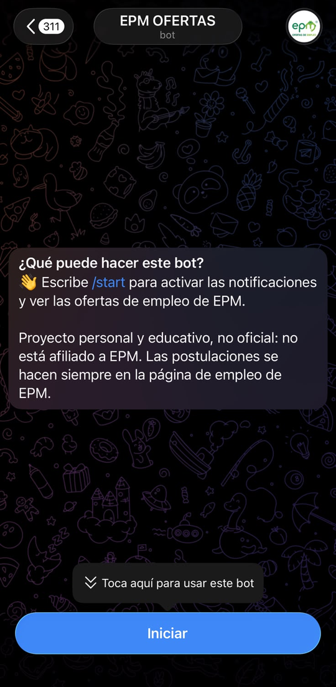
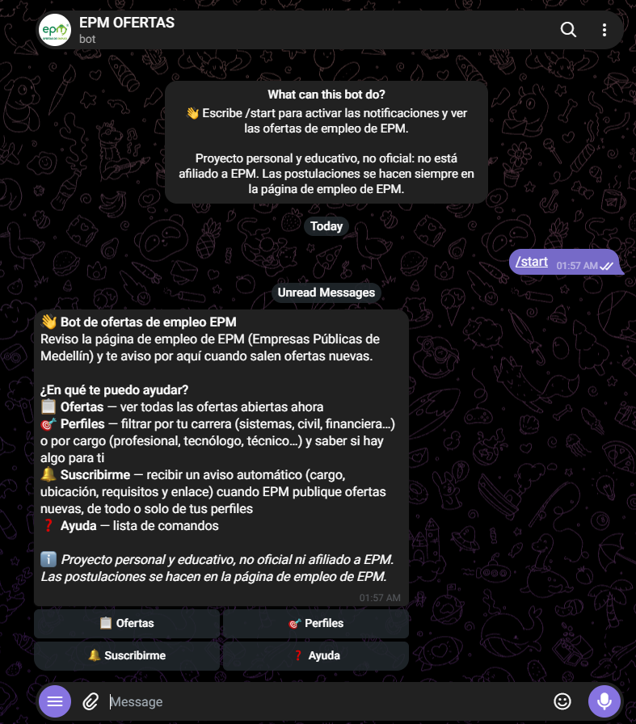
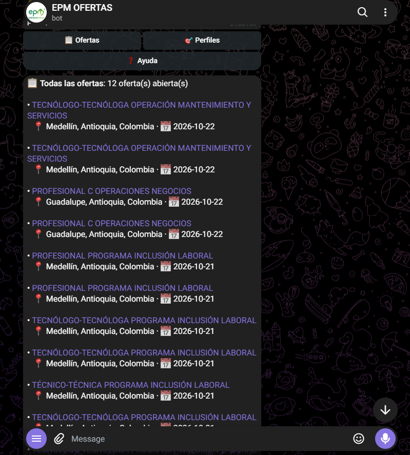
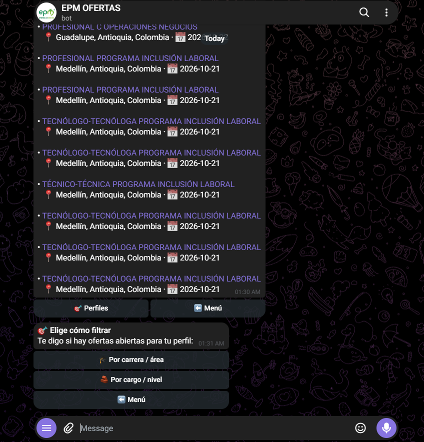
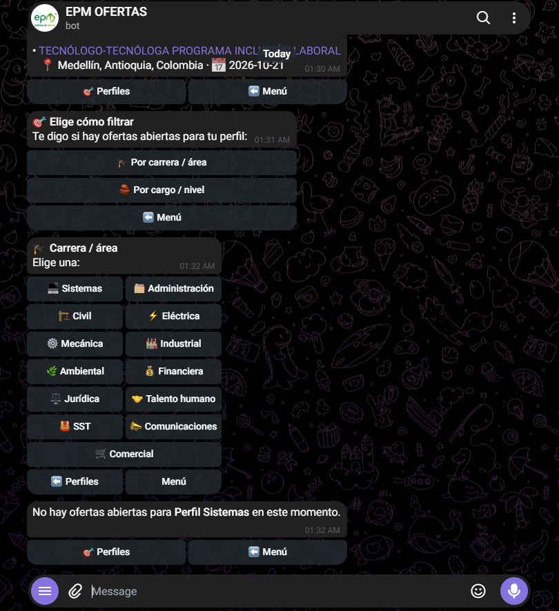
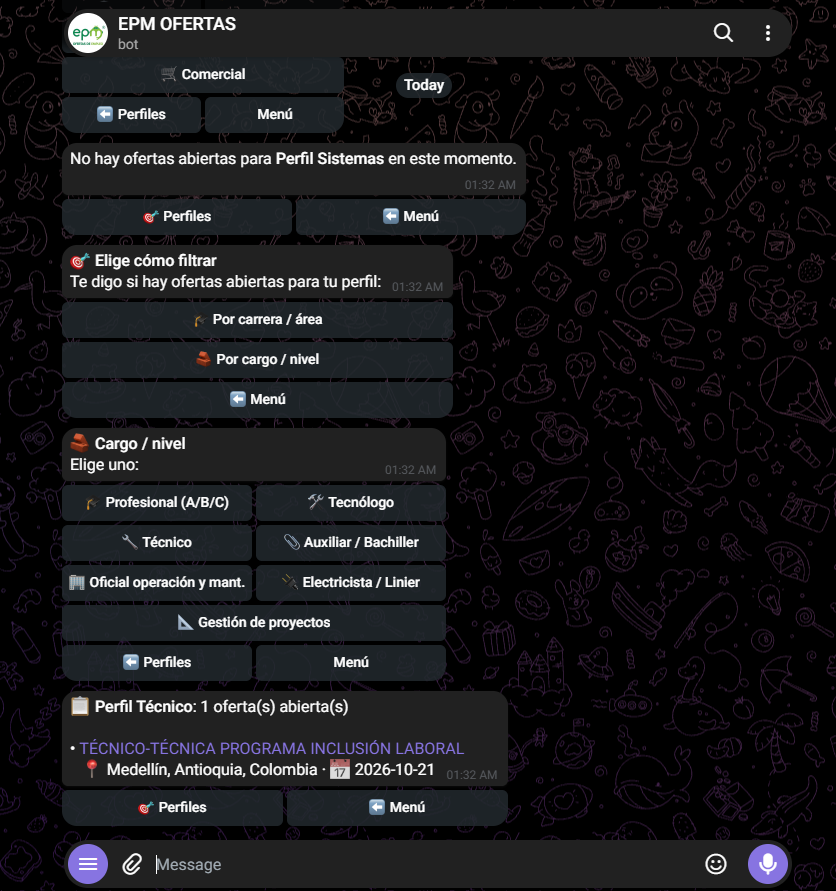
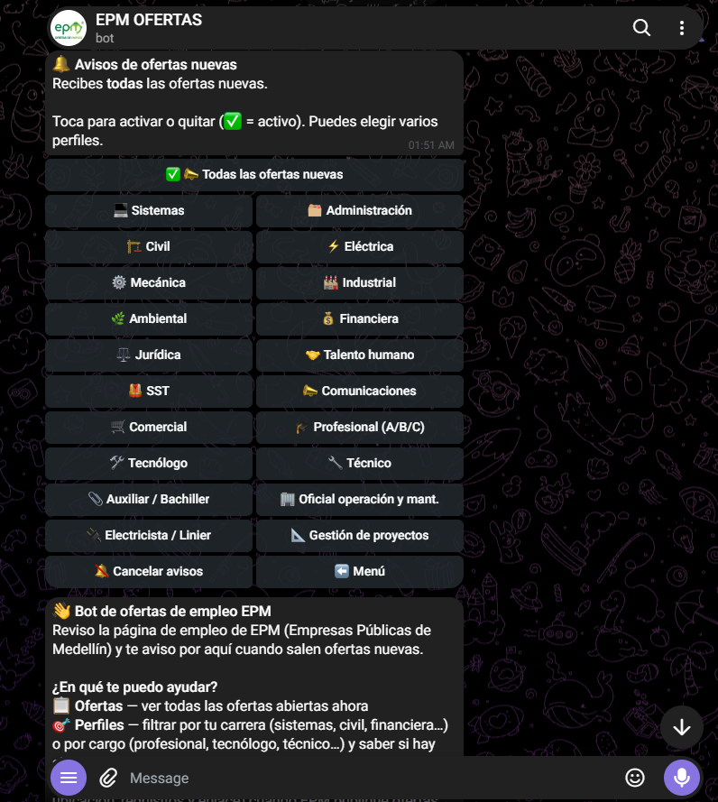
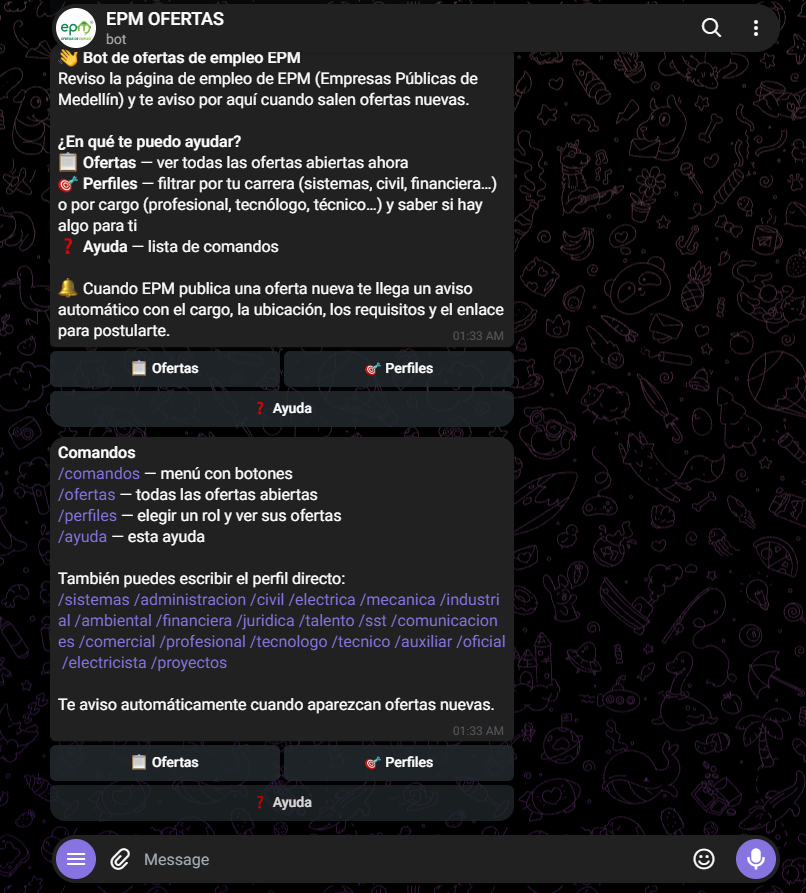

# Notificador de ofertas EPM → Telegram

Consulta la API REST pública de Oracle HCM que usa la página de empleo de EPM y avisa por Telegram de las ofertas nuevas; además, la sección **🏢 GrupoEPM** muestra (y puede avisar) las convocatorias de la Fundación EPM, otra fuente distinta. Corre en un **Cloudflare Worker con base de datos D1 y una cola**, en el plan gratuito: los comandos y botones responden en **décimas de segundo**, las ofertas nuevas se revisan cada 30 minutos, es **100 % gratis**, no usa servidores y no depende de ningún computador encendido.

## Pruébalo

<p align="center">
  <a href="https://t.me/epmofertasbot"></a>
  <br>
  <b><a href="https://t.me/epmofertasbot">Abrir @epmofertasbot en Telegram</a></b>
  <br>
  <sub>Escanea el QR con la cámara de tu celular o toca el enlace</sub>
</p>

1. Pulsa **Iniciar / Start**.
2. Toca **🎯 Perfiles** para ver si hay ofertas de tu carrera o cargo.
3. Toca **🔔 Suscribirme** y elige *todas las ofertas* o solo tus perfiles: te avisará cuando EPM publique algo nuevo.
4. Toca **🏢 GrupoEPM** para ver las convocatorias vigentes de la Fundación EPM (los avisos de las nuevas son opcionales y vienen apagados).

> El bot solo guarda el id de tu chat para enviarte los avisos. Puedes cancelarlos cuando quieras desde el mismo menú.
> ⚠️ Proyecto personal y educativo, **no oficial ni afiliado a EPM** (ver [Aviso legal](#aviso-legal)). Las ofertas se postulan siempre en la página de empleo de EPM.
> ⚡ Los comandos y botones responden de inmediato y las ofertas nuevas se avisan en la siguiente revisión, cada ~30 minutos (ver [Cómo funciona](#cómo-funciona)).

## Aviso legal

- Este es un **proyecto personal, educativo y sin fines de lucro**, hecho para mantenerme al tanto de las ofertas laborales de EPM.
- **No está afiliado, patrocinado ni respaldado por EPM (Empresas Públicas de Medellín).** No tengo ningún derecho sobre EPM ni sobre su nombre, marca o logotipo, que pertenecen a sus titulares. Las menciones a EPM son únicamente para indicar de dónde proviene la información.
- No copia ni redistribuye el sitio de EPM: consulta la misma API pública que usa su página de empleo y solo reenvía datos básicos de cada oferta (título, ubicación, fecha, un resumen breve y requisitos) con **enlace a la fuente oficial**. Toda postulación se hace en la página oficial de EPM.
- Sin garantías: la información puede estar desactualizada o incompleta. Verifica siempre en el sitio oficial. Desconfía de cualquier oferta que te pida dinero.
- Si eres titular de derechos y quieres que algo se modifique o se retire, abre un *issue* en este repositorio y se atenderá.

## Cómo se ve

> 🔍 Toca o haz clic en cualquier imagen para verla en tamaño completo.

### 1. Primer ingreso

Al abrir el bot por primera vez, Telegram muestra qué hace y el botón **Iniciar**.

<p align="center">
  <a href="docs/screenshots/bienvenida.png"></a>
</p>

### 2. Menú de inicio

Con `/start` (o `/comandos`) el bot se presenta y ofrece un menú con botones: **Ofertas**, **Perfiles**, **Suscribirme** y **Ayuda**.

<p align="center">
  <a href="docs/screenshots/start1.png"></a>
</p>

### 3. Todas las ofertas

**📋 Ofertas** (o `/ofertas`) lista las ofertas abiertas con cargo, ubicación, fecha y enlace a la página oficial de EPM.

<p align="center">
  <a href="docs/screenshots/ofertas.png"></a>
</p>

### 4. Cómo filtrar

**🎯 Perfiles** (o `/perfiles`) permite filtrar por carrera o por cargo y responde si hay ofertas para ti.

<p align="center">
  <a href="docs/screenshots/perfiles.png"></a>
</p>

### 5. Por carrera / área

Sistemas, civil, eléctrica, financiera, jurídica, talento humano y más.

<p align="center">
  <a href="docs/screenshots/perfilesCarrera.png"></a>
</p>

### 6. Por cargo / nivel

Profesional, tecnólogo, técnico, oficial de operación y mantenimiento, electricista… Si hay coincidencias, las lista; si no, te lo dice.

<p align="center">
  <a href="docs/screenshots/perfilesCargo.png"></a>
</p>

### 7. Suscribirse a avisos

**🔔 Suscribirme** (o `/suscribir`): elige *todas las ofertas* o uno o varios perfiles (✅ = activo) y recibe un aviso automático cuando EPM publique algo nuevo. Se cancela con **🔕 Cancelar avisos**.

<p align="center">
  <a href="docs/screenshots/suscribirse.png"></a>
</p>

### 8. Ayuda

`/ayuda` lista los comandos disponibles.

<p align="center">
  <a href="docs/screenshots/ayuda.png"></a>
</p>

## Qué muestra cada oferta

Cada oferta (en el botón **📋 Ofertas**, en los perfiles y en el aviso de oferta nueva) usa la misma tarjeta:

```
🆕 TECNÓLOGO-TECNÓLOGA OPERACIÓN MANTENIMIENTO Y SERVICIOS     ← el título es el enlace a la oferta
👥 Dirigida a: Servidores de EPM — «Servidores/as de EPM que hacen parte de la Gerencia…»
🎓 Título requerido: Título de pregrado tecnológico en campos amplio Ingeniería, Industria y Construcción…
💼 Experiencia requerida: Cuatro (4) años de experiencia laboral en supervisión técnica en contratos de…
📍 Medellín, Antioquia, Colombia
📅 Publicada: 22 oct 2026 · ⏰ Cierra: 27 oct 2026 (en 3 días)
Realizar actividades técnicas, operativas y administrativas requerida en los procesos de…
```

El 🆕 aparece solo en el aviso de oferta nueva, que además añade el salario y el contrato.

- **Título clicable.** El enlace se arma con el ID validado de la oferta y la plantilla pública de EPM; nunca con una URL que venga dentro del contenido de EPM. La vista previa del enlace está desactivada para que varias ofertas no llenen el chat de tarjetas.
- **🎓 Título y 💼 experiencia requeridos.** Salen de los campos explícitos *Título requerido* y *Experiencia requerida* que EPM publica en el detalle de cada oferta (no se deducen de la descripción). Se quita el relleno administrativo («Según lo descrito…», códigos CINE-F) y se corta en frontera de palabra a ~150 caracteres. Si EPM no trae el campo, la línea no aparece.
- **Descripción breve.** Campo `ShortDescriptionStr` de EPM (texto plano), unos 350 caracteres, cortado en frontera de palabra.
- **Fechas en hora de Bogotá (UTC−5).** EPM entrega la fecha límite como `…T04:59:00Z`, que en Colombia son las **23:59 del día anterior**; por eso se convierte antes de mostrarla. Se indica «cierra hoy», «cierra mañana» o «en N días». Las ofertas **ya cerradas no se presentan como disponibles**: se omiten del botón (con un aviso de cuántas son) y no se notifican.
- **Si falta algún dato:** sin fecha límite se muestra «No especificada»; si el detalle de EPM no responde, la tarjeta sale igual con los datos del listado, «No determinado» y la descripción del listado (o «Descripción no disponible»).

### ¿Cómo se determina «Dirigida a»?

La API de EPM **no tiene un campo que distinga ofertas internas de externas**. Se combina lo que sí hay:

| Fuente | Resultado | Fiabilidad |
|---|---|---|
| `RequisitionType = Privado` (campo explícito) | «Por invitación (proceso privado)» | Alta |
| Frase «Público objetivo» del texto de la oferta que menciona «servidores» | «Servidores de EPM» | Heurística |
| …que dice «abierto a la comunidad» o «público en general» | «Público general» | Heurística |
| Ambas cosas, ninguna, o servidores de otra empresa (CHEC, ESSA…) | «No determinado» | — |

Cuando la etiqueta sale del texto, se muestra el **fragmento literal** entre «…» para que cualquiera pueda comprobarlo. Con las 20 ofertas que la API publicaba el 2026-10-24 el resultado coincide con lo que dice cada oferta (12 de servidores, 1 abierta a la comunidad, 7 por invitación), pero son pocas y las redactó el mismo equipo: si EPM cambia la redacción, la etiqueta puede caer en «No determinado» o equivocarse, y por eso el fragmento siempre acompaña a la etiqueta. Varias ofertas del Programa de Inclusión Laboral van dirigidas a *personas con discapacidad que ya son servidores*; el fragmento lo deja claro.

> **Alcance:** el bot vigila el sitio «EPM Sitio» (`CX_1`), que el 2026-10-24 tenía 12 de las 20 ofertas que expone la API. Las otras 8 están en sitios privados (por invitación) o de filiales (CHEC, ESSA…) y no se vigilan. Por eso «Público general» casi no aparece hoy.

> Las capturas de «Cómo se ve» son anteriores a esta tarjeta y muestran el formato previo de las ofertas.

## GrupoEPM: convocatorias de la Fundación EPM

Una segunda fuente, **distinta del portal de empleo Oracle HCM** de EPM: la página de convocatorias de la Fundación EPM
(<https://www.grupo-epm.com/fundacion-grupo-epm/trabaja-con-nosotros/convocatorias/>). Cada convocatoria tiene el perfil del cargo en un PDF de `grupo-epm.com` y se postula en un enlace externo (`login.airavirtual.com`). El botón **🏢 GrupoEPM** (o `/grupoepm`) muestra las convocatorias **vigentes** (fecha de cierre futura, no canceladas) leídas de la caché en D1, nunca de la página en vivo, así que responde igual de rápido que el resto.

```
🏢 025-26 TECNÓLOGO(A) DE COMUNICACIONES            ← el título es el enlace al PDF del perfil
⏰ Cierra: 22 nov 2026 (en 2 días)
📍 Ciudad: Medellín
👥 Personas requeridas: 1
🏗️ El cargo se desarrolla en: el Edificio Inteligente EPM
📌 Condiciones: Esta vacante aplica para personas residentes del municipio relacionado     ← solo si las hay
👉 Postúlate aquí
```

- **Nada se inventa.** Cada dato sale del texto de la convocatoria; si no está, dice «No especificado». La ciudad, el lugar y las condiciones se extraen de frases de texto libre («…para trabajar en la ciudad de…, el cargo se desarrollará principalmente en…», «Esta vacante aplica para personas residentes del municipio…», «Esta convocatoria está dirigida a: …»), así que dependen de cómo las redacte la Fundación.
- **Avisos de convocatorias nuevas:** interruptor propio **🔔 Avisos GrupoEPM** (en la vista de GrupoEPM y en el menú de suscripción), **apagado por defecto**. Va dentro del mismo registro cifrado de la suscripción (campo `gepm`); las suscripciones anteriores se leen como «apagado» y **«🔕 Cancelar avisos» lo apaga también**. Los chats autorizados que reciben todas las ofertas de Oracle **no** reciben GrupoEPM si no lo activaron. No se avisa a quien no lo activó.
- **Cómo se detecta una convocatoria:** la página es HTML estático de Adobe Experience Manager, de la más nueva a la más vieja. Cada convocatoria es un encabezado `<h3 class="cmp-title__text">` con el formato `NNN-AA CARGO: Fecha de cierre … hrs.` (a veces `: Cerrado` o `: Cancelado`). Los bloques «Notificación N», fe de erratas y resultados de etapas son otros bloques sin esa clase y **no son convocatorias**; solo una «Cancelación proceso de selección» marca su convocatoria como cancelada. La clave de deduplicación es el número **NNN-AA**.
- **Una sola vez:** una convocatoria se avisa una vez; un cambio posterior (nueva fecha de cierre, fe de erratas) solo actualiza sus datos y **no repite el aviso**. *(Avisar los cambios de fecha de cierre sería útil, pero no está implementado.)* Una convocatoria nueva que ya esté cerrada, cancelada o sin fecha tampoco se avisa. Cada par (convocatoria, destinatario) se reclama en D1 antes de enviar, por eso ni un reintento de la cola ni dos revisiones seguidas duplican un aviso.
- **Primera lectura:** guarda todo lo que ya estaba como visto **sin avisar** (ni siquiera lo vigente).
- **Fechas:** `domingo 22 de noviembre de 2026 - 23:59 hrs.` en zona America/Bogota. Se aceptan meses completos o abreviados, días con cero, `a.m.`/`p.m.` y fechas sin hora (fin de ese día); el nombre del día se ignora (se confía en la fecha). Una fecha imposible («31 de febrero») no se lee y no se inventa otra.

### Cómo se lee la página (sin gastar CPU del cron)

El cron solo **encola un mensaje «revisar GrupoEPM»** (cada 60 minutos, no en cada tick). La descarga, el análisis y la comparación los hace el **consumidor de la cola**, nunca el cron ni el webhook.

- **Lectura parcial.** La página completa pesa unos 600 KB y la convocatoria más nueva va primero: se lee como flujo y se **corta tras las 12 convocatorias más nuevas o 160 KB** (en la práctica ~130 KB) y se cancela la descarga.
- **Petición condicional.** El servidor admite `ETag`/`If-None-Match`: si la página no cambió responde **304** y no se analiza nada (verificado desde la red de Cloudflare).
- **Contenido externo no confiable.** Se quitan etiquetas y entidades, se eliminan los caracteres que invierten u ocultan texto, se recortan los textos largos (antes de escapar, sin partir entidades) y todo se escapa al enviarlo a Telegram. Los enlaces solo se aceptan si son **https** y su host es `www.grupo-epm.com` o `login.airavirtual.com`; cualquier otro se descarta y la tarjeta sale sin ese enlace (en la página real hay un enlace al PDF en un dominio de Adobe y una postulación en `kudert.com`, ambos descartados).
- **Si la estructura cambia.** Si la página responde 200 pero no se encuentra ninguna convocatoria, o un encabezado no sigue el formato, **no se marca nada como visto ni se avisa a nadie**; se registra el fallo (sin datos de usuarios) y se avisa **solo al administrador**, como máximo una vez cada 12 h. El botón distingue «no hay convocatorias vigentes» de «no he podido leer la página» (y, si la lectura falla desde hace horas, avisa de que muestra lo último que pudo leer).

### Interruptor general y modo de prueba

Una bandera en D1 (`meta`, clave `gepm_mode`) controla todo. **Por defecto `off`.**

| Modo | Qué hace |
|---|---|
| `off` | Inerte: no se descarga la página, el botón dice que la sección aún no está activa. |
| `test` | Se revisa y se guarda la página y el botón muestra las convocatorias, pero los avisos de convocatorias nuevas salen **solo al administrador** (una vez). |
| `live` | Además se avisa a quienes activaron **🔔 Avisos GrupoEPM**. |

El administrador (**solo desde su chat privado con el bot**; cualquier otro chat, incluido él mismo desde un grupo, recibe la misma respuesta que un comando desconocido, sin confirmar que existen) lo cambia con `/gepmodo off | test | live`; `/gepmodo` sin argumento muestra el estado (modo, última lectura, vigentes, pendientes) y `/gepmprueba NNN-AA` le envía **solo a él** la vista previa del aviso de una convocatoria ya guardada. Equivalente por línea de comandos:

```bash
npx wrangler d1 execute epm-bot-db -c wrangler.local.toml --remote --command "UPDATE meta SET v = 'live' WHERE k = 'gepm_mode'"
```

(`off` o `test` para volver atrás; la siguiente revisión empieza en cuanto toca el cron.) Si una convocatoria se detectó mientras estaba en `test`, queda pendiente y, al pasar a `live`, se avisa a los suscriptores **si sigue vigente** (el administrador no la recibe dos veces).

### Aislamiento en la cola

La revisión de GrupoEPM comparte la cola con las ofertas del portal, pero **no puede frenarlas**: la cola entrega un mensaje por invocación (`max_batch_size = 1`), y una revisión que falla tiene su propia política: **un solo reintento** a los 5 min (nunca más, aunque Cloudflare siga entregándola), un límite diario de D1 la descarta sin reintentar, no encola nada por su cuenta y retrasa la próxima revisión al menos 1 h. Las ofertas del portal conservan su política de siempre (reintentos a los 60 s, hasta 3). Está probado con el manejador real de la cola y un fallo simulado. Lo que no se puede simular en local es una invocación que agote su CPU: Cloudflare la reintenta sola, como mucho `max_retries = 3` veces, y tampoco bloquea a las demás.

### Limitaciones

- **Depende del formato de la página**, que no es una API y puede cambiar sin aviso; por eso hay alerta al administrador cuando no se puede leer.
- Solo se leen las 12 convocatorias más nuevas; las cerradas no se muestran; las «Cerrado»/«Cancelado» antiguas se guardan sin fecha.
- Los datos de texto libre (ciudad, dónde se desarrolla el cargo, condiciones) son una extracción por frases; si la redacción cambia, el dato puede quedar en «No especificado». La tarjeta no reproduce el perfil del cargo: está en el PDF.
- No es un servicio oficial de la Fundación EPM ni de EPM (ver [Aviso legal](#aviso-legal)).

## Cómo funciona

Todo corre en **Cloudflare, plan gratuito, sin tarjeta**: un [Worker](bot/src/index.js) con una base **D1** y una **cola**. No hay ningún servidor encendido ni depende de mi computador. El detalle técnico (límites, esquema, secretos, pruebas) está en [bot/README.md](bot/README.md).

```
 Comandos y botones
 Telegram ──webhook──▶ Worker  fetch()      valida el secreto, procesa la update en D1 y responde (décimas de segundo)

 Ofertas nuevas
 Cron Trigger (*/30) ─▶ Worker  scheduled()  lista EPM, compara con D1 y ENCOLA los ids nuevos
 Cola ────────────────▶ Worker  queue()      una oferta por invocación: detalle, tarjeta y reparto de avisos (≤35 envíos por mensaje)
```

- **Responde al instante.** Cada pulsación es una sola invocación del Worker que lee/escribe D1 y contesta a Telegram: **~0,25 s** un `/start` y **~0,8 s** `/ofertas` con 12 tarjetas (medido en producción, ver [cifras](#cifras-medidas-en-cloudflare)). Ya no hay arranque de un job de Actions (antes 11–25 s).
- **El cron es ligero a propósito.** El plan gratuito da 10 ms de CPU a un cron: solo lista EPM, lee en **una consulta** el estado de los ids del listado, compara en memoria, encola y escribe todo en **una sola escritura atómica** (3 viajes a D1).
- **Orden seguro del estado.** Una oferta solo se marca como vista **después** de encolar su aviso. Si el cron se corta justo antes, la siguiente ejecución la vuelve a detectar (no se pierde); si se corta justo después de encolar, puede encolarla dos veces, pero **nadie recibe dos avisos**: cada par (oferta, destinatario) se reclama en D1 *antes* de enviar y un reintento solo envía a quien falló. Está cubierto por pruebas ([cron.test.mjs](bot/test/unit/cron.test.mjs)).
- **Estado en D1**, con suscriptores y chats **cifrados** (AES-GCM con claves derivadas de `STATE_KEY`; la clave de fila es un HMAC del chat, así que ni el chat id ni los perfiles están en claro). Cambios con control de versión y elecciones absolutas: repetir una pulsación no hace daño.
- **Deduplicación por `update_id`** para los cambios de estado, límite por chat (8 updates cada 10 s) y 5xx solo si falló algo y no se envió nada (Telegram reintenta); los límites de D1 se contestan con 200 para no provocar reintentos en cadena.
- **Respaldos:** los 7 días de Time Travel de D1 y una **copia local a demanda** (`node bot/scripts/backup-local.mjs`, a una carpeta ignorada por git). El respaldo automático semanal a GitHub está **desactivado** (ver [Respaldos](#respaldos)).
- **Sin datos en logs:** observabilidad desactivada y los errores solo registran su nombre. Se revisó el `wrangler tail` de producción: ningún token, clave ni chat id.

### Cifras medidas en Cloudflare

Medido el **2026-10-26** sobre el Worker desplegado (`wrangler tail`, CPU real que mide Cloudflare). Límite gratuito: **10 ms de CPU** por invocación HTTP o de cron.

| Qué | CPU | Tiempo total en el Worker |
|---|---|---|
| `/start`, botón de menú | 1–3 ms | ~0,26 s |
| `/ofertas` (12 tarjetas, 3 mensajes), `/tecnologo` | 3–7 ms | 0,5–0,8 s |
| Suscribir / quitar perfil (D1 + cifrado) | 4–7 ms | ~0,5 s |
| Cron real **sin** ofertas nuevas (cada 30 min) | **5–8 ms** (5, 8, 5, 6 en los 4 ticks normales) | 1,4–3 s |
| Primer cron tras el corte (registró los comandos del bot, una sola vez) | 10 ms | 4,2 s |
| Cron con **1 oferta nueva** (Worker de prueba aparte, EPM real) | 3 y 8 ms | 1,5–2,7 s |
| Cron con **3 ofertas nuevas a la vez** (ídem) | 4 y 4 ms | ~1,1–1,2 s |
| Cola: procesar **una** oferta (detalle real de EPM, tarjeta, caché, destinatarios) | 13–26 ms la primera de una ráfaga, 6–8 ms las siguientes | 1–2 s |
| Cola: reparto de un aviso (sin destinatarios en la prueba) | 0–1 ms | — |
| Cola: **revisar GrupoEPM**, lectura completa (~120–130 KB, 12 convocatorias; Worker de prueba, página real) | 11–30 ms (16–28 la primera, con 12 altas) | 0,3–1,2 s |
| Cola: revisar GrupoEPM con **304** (página sin cambios) | 4–7 ms | 0,3–0,9 s |
| Cron en el tick que encola la revisión de GrupoEPM (Worker de prueba) | 2–8 ms (8 la primera, 2–3 después) | 1–1,4 s |

Cómo leer la tabla:

- **GrupoEPM, dónde se va el CPU** (Worker de diagnóstico en Cloudflare, invocación HTTP caliente): la red cuesta 0 ms; leer el flujo y analizar la página, 4–9 ms; todo el trabajo de la revisión (`processGepm`), **7 ms** con la página completa y **1–2 ms** con 304. En la cola se midió más (11–30 ms) porque cada invocación de la cola arranca un entorno nuevo y carga el código. **El cron no descarga ni analiza la página**: solo encola el mensaje, y su CPU sigue en su rango habitual (2–8 ms). Medido en Node con la página real completa (598.292 caracteres): se leen unos 131 KB y el análisis de las 12 convocatorias cuesta ~1,3 ms en caliente.

- **El caso «con oferta nueva» no es más caro para el cron** porque el cron solo encola ids; el detalle, la limpieza del HTML, la extracción de título y experiencia y el formato de la tarjeta se hacen en la cola. En local (JS puro, estado caliente) el cron entero cuesta < 1 ms y los pasos de una oferta suman ~2,3 ms (detalle 1,3 · limpieza 0,15 · tarjeta 0,2 · destinatarios 0,35); el CPU real de Cloudflare es mayor porque incluye E/S, TLS y arranque en frío, que no se pueden medir en local.
- **La cola supera 10 ms y termina bien en el plan gratuito** (13–26 ms medidos, resultado `ok`). La documentación de Queues indica 30 s de CPU por defecto para el consumidor en los dos planes, aunque la página general de límites de Workers no lista un límite para consumidores. Se mantiene el diseño prudente: un mensaje (una oferta) por invocación y avisos de ≤35 destinatarios, por si el límite cambiara.
- **Margen del cron: 2–5 ms.** Es la cifra ajustada del sistema; los ticks reales están entre 5 y 8 ms y el de 10 ms fue el único que registró los comandos. Si algún día pasara de 9 ms, lo primero que se recortaría es el borrado de ofertas caducadas (`DELETE … NOT IN`) y la escritura del contador de uso en los ticks sin novedades.
- **Cuotas de GrupoEPM (estimadas desde el código y la prueba):** una revisión por hora = 24 descargas al día; por revisión se leen ~15–20 filas de D1 y se escriben ~3–4 (siempre la fecha de la última lectura y de la siguiente; el ETag solo si cambia), es decir ~450 lecturas y ~100 escrituras al día frente a 5.000.000 y 100.000; ~70 operaciones de cola al día frente a 10.000.
- **Cuotas diarias:** un tick lee ~80–90 filas de D1 y escribe 1–7. A 48 ticks/día son ~4.300 lecturas (el límite son 5.000.000) y ~50–60 escrituras (el límite son 100.000).
- **Aún sin medir en producción:** el reparto de avisos reales a suscriptores por la cola (probado en local y con un Worker de prueba sin destinatarios). Se verificarán con la primera oferta nueva real.

## Desplegar, rotar secretos y volver atrás

Requisitos: cuenta gratuita de Cloudflare y `npx wrangler login`. Los valores sensibles se cargan siempre por entrada estándar con `wrangler secret put` (o `node bot/scripts/load-secrets.mjs`, que los lee de `.env` sin imprimirlos): nunca van en el repositorio ni en la línea de comandos.

```bash
cd bot && npm install
cp wrangler.toml wrangler.local.toml     # pon tu database_id (archivo ignorado por git)
npx wrangler d1 create epm-bot-db
npx wrangler d1 migrations apply epm-bot-db -c wrangler.local.toml --remote
npx wrangler queues create epm-bot-jobs
node scripts/load-secrets.mjs            # TELEGRAM_BOT_TOKEN, WEBHOOK_SECRET, STATE_KEY, TELEGRAM_CHAT_ID
npx wrangler deploy -c wrangler.local.toml
node ../epm-notifier.mjs --set-webhook=https://<worker>.<subdominio>.workers.dev
node ../epm-notifier.mjs --webhook-info   # activo: sí | pendientes: 0
```

Hasta que `live = 1` en la tabla `meta` el cron no avisa nada (sirve para probar). El procedimiento de corte que se siguió el 2026-10-26 está en [bot/README.md](bot/README.md#corte-activar-el-sistema-nuevo).

**Rotar secretos**
- **Secreto del webhook:** nuevo valor en `.env` → `node bot/scripts/load-secrets.mjs` → `node epm-notifier.mjs --set-webhook=<url>`.
- **Token del bot:** `/revoke` en @BotFather → actualiza `.env` → `load-secrets.mjs` → vuelve a registrar el webhook.
- **`STATE_KEY`:** no se puede cambiar sin migrar: cifra suscriptores y chats (y los respaldos automáticos, si algún día se activan). Si se pierde, las suscripciones no se pueden descifrar (los usuarios tendrían que volver a suscribirse). Guárdala en un gestor de contraseñas.

**Vuelta atrás al sistema anterior** (sigue intacto pero desactivado: Worker `epm-notifier-webhook`, workflow y rama `state`):
1. `UPDATE meta SET v='0' WHERE k='live'` en D1 (el cron nuevo deja de avisar).
2. Copiar a `state` lo ya avisado para que el viejo no lo repita: `node bot/scripts/rollback-seen.mjs --ids <ids.json> --push`.
3. `node epm-notifier.mjs --set-webhook=https://epm-notifier-webhook.<subdominio>.workers.dev`.
4. `gh workflow enable epm-notifier.yml` y devolver `crons = ["7,37 * * * *"]` a `worker/wrangler.toml` (`npx wrangler deploy` en `worker/`).

## Pendientes y riesgos

- **D1 es el único almacén del estado.** Mitigaciones: Time Travel (7 días) y las copias locales que hagas con `backup-local.mjs` (ver [Respaldos](#respaldos)). **No hay respaldo automático fuera de Cloudflare**: si no haces copias locales, solo cuentas con esos 7 días.
- **Cuotas diarias.** Si se agotaran (100.000 peticiones/día, 100.000 escrituras o 5.000.000 lecturas de D1), el bot deja de responder hasta las 00:00 UTC; no se cobra nada. El consumo normal es una fracción mínima de esos límites, pero un abuso masivo podría alcanzarlas.
- **CPU del cron ajustada** (5–8 ms de 10, ver arriba): vigilar el valor tras cambios de código.
- **Cron de Cloudflare:** puede retrasarse unos minutos; la propagación tras desplegar tarda hasta 15 min.
- **Página de GrupoEPM:** no es una API: es HTML que puede cambiar sin aviso. Si no se encuentra ninguna convocatoria o un encabezado no sigue el formato, no se marca ni se avisa nada y se alerta solo al administrador (ver [GrupoEPM](#grupoepm-convocatorias-de-la-fundación-epm)). La sección viene **apagada** (`gepm_mode = off`) y pasa por un modo de prueba antes de avisar a nadie.
- **CPU de la revisión de GrupoEPM en la cola (11–30 ms).** La documentación de Queues dice 30 s por defecto para el consumidor, pero también que comparte los límites por invocación de cualquier Worker (10 ms en el plan gratuito); en esta cuenta gratuita las invocaciones de la cola han terminado siempre bien con 13–30 ms. No es una garantía documentada: si Cloudflare empezara a aplicar 10 ms a la cola, la revisión de GrupoEPM (y el procesamiento de ofertas nuevas) fallarían.
- **API de EPM:** no es un contrato público. Si cambia su estructura, el cron falla de forma visible, cuenta los fallos seguidos y avisa al administrador al tercero (~1,5 h). Los campos «Título requerido», «Experiencia requerida» y «Dirigida a» dependen en parte del texto libre de cada oferta (ver abajo).
- **Sistema anterior:** desactivado, no borrado. Se limpiará (`worker/`, workflow, `epm-notifier.mjs`, `k8s/`) en un cambio aparte, cuando el nuevo lleve un tiempo estable.

## Respaldos

**El respaldo automático semanal a GitHub está desactivado** (`BACKUP_ENABLED = "0"` en [bot/wrangler.toml](bot/wrangler.toml); el código sigue en [backup.js](bot/src/lib/backup.js), inerte). Motivos:

- **El repositorio es público:** los archivos cifrados quedarían en el historial para siempre, también los de semanas pasadas. Aunque van cifrados con AES-GCM, su seguridad pasa a depender solo de `STATE_KEY`, y su tamaño y fechas son visibles (se deduce de forma aproximada cuántos suscriptores hay).
- **Permiso amplio del token:** escribir en una rama exige un token con *Contents: Read and write* sobre el repositorio. Ese token también podría escribir en `main`; el código solo toca la rama `d1-backup`, pero el límite lo pone el permiso, no el código. Guardarlo en el Worker amplía lo que se puede perder si el Worker o su cuenta se ven comprometidos.

**Qué hay en su lugar:** Time Travel de D1 (7 días, `wrangler d1 time-travel restore`) y una **copia local a demanda**:

```bash
node bot/scripts/backup-local.mjs          # → bot/backups/d1-AAAA-MM-DD-HHMM.sql (ignorada por git; conserva las últimas 12)
```

Restaurar y guardar la copia: ver [bot/README.md](bot/README.md#respaldo). Para reactivar el automático, ver la misma sección.

## Uso del bot: perfiles, suscripciones y comandos

### Perfiles (filtro por carrera)
Perfiles disponibles: `sistemas`, `administracion`, `civil`, `electrica`, `mecanica`, `industrial`, `ambiental`, `financiera`, `juridica`, `talento`, `sst`, `comunicaciones`, `comercial` y `tecnico` (técnicos/tecnólogos/operarios). Cada uno incluye términos afines (p. ej. `sistemas`: ingeniería de sistemas/informática/software, TI, desarrollador, datos, ciberseguridad, nube, telemática…) y los busca como palabra completa en título y descripción. Para añadir perfiles o términos, edita [bot/src/lib/profiles.js](bot/src/lib/profiles.js).

### Usuarios, suscripciones y grupos
- **Público (cualquiera):** puede consultar (`/ofertas`, `/perfiles`, `/sistemas`…) y **suscribirse** con `/suscribir` (botón 🔔). Cada chat elige *todas las ofertas* o uno o varios perfiles y solo recibe lo suyo. Se guarda únicamente el chat (cifrado) y los perfiles elegidos; si alguien bloquea el bot, su suscripción se elimina sola. Límite: `MAX_SUBS` (500 por defecto).
- **Administrador y chats autorizados:** `TELEGRAM_CHAT_ID` admite varios ids separados por coma y **el primero es el administrador**. Los autorizados reciben todas las ofertas nuevas; los avisos de error solo te llegan a ti.
- **Grupo:** añade el bot; cualquier miembro puede suscribir *el grupo* con los botones. Como administrador, `/activar` en el grupo lo autoriza (recibe todo) y `/desactivar` lo quita.
- **Administración** (solo tú, en privado): `/agregar <id>`, `/quitar <id>`, `/chats` y `/uso` (consumo del día).

### Comandos de Telegram
`/comandos` (menú), `/ofertas` (todas), `/grupoepm` (convocatorias de la Fundación EPM), `/perfiles`, `/suscribir`, `/sistemas` (ofertas abiertas de un perfil), `/ayuda`.

Solo el administrador, en su chat privado (para cualquier otro chat estos dos comandos no existen: «Comando no reconocido»): `/gepmodo off | test | live` (interruptor general de GrupoEPM), `/gepmodo` (estado) y `/gepmprueba NNN-AA` (vista previa de un aviso, solo para él).

## Versión anterior (desactivada)

Hasta el 2026-10-26 el bot corría en GitHub Actions (un job por comando, 11–25 s) con un Worker de Cloudflare que disparaba el workflow, y guardaba el estado cifrado en la rama `state`. Ese código sigue en el repositorio solo como vuelta atrás: [epm-notifier.mjs](epm-notifier.mjs), [worker/](worker/), el workflow [epm-notifier.yml](.github/workflows/epm-notifier.yml) (desactivado), `scripts/` y `k8s/`. **No lo actives a la vez que el sistema nuevo**: los dos contestarían y avisarían por el mismo bot.

## Seguridad

- Los secretos solo existen como *secrets* del Worker (`wrangler secret put`) y en un `.env` local ignorado por git. Nunca en el repositorio, ni en `wrangler.toml` (el `database_id` real vive en `wrangler.local.toml`, también ignorado).
- El Worker rechaza con 401 cualquier petición sin el header secreto correcto (comparación en tiempo constante, antes de leer el cuerpo), limita el tamaño del cuerpo y reduce cada update a lo mínimo.
- Suscriptores y chats van cifrados en D1; las copias locales los contienen cifrados (sin `STATE_KEY` no se pueden leer).
- Los logs no incluyen tokens, claves, chat ids ni textos de usuarios (comprobado en producción con `wrangler tail`).
- Si sospechas que el token del bot se filtró, revócalo con @BotFather (`/revoke`), actualiza el secreto y vuelve a registrar el webhook.

## Historial de cambios

- **2026-11-20 — Sección GrupoEPM: convocatorias de la Fundación EPM.** Nueva fuente (distinta del portal Oracle HCM): botón **🏢 GrupoEPM** con las convocatorias vigentes (tarjeta con cargo, cierre en Bogotá, ciudad, personas, dónde se desarrolla, condiciones y enlace «Postúlate») y un interruptor **🔔 Avisos GrupoEPM**, apagado por defecto y dentro de la suscripción cifrada. La página se lee en el consumidor de la cola (lectura parcial de ~130 KB y petición condicional con ETag), nunca en el cron; solo se aceptan enlaces https de `www.grupo-epm.com` y `login.airavirtual.com`. Interruptor general `gepm_mode` (`off`/`test`/`live`) con modo de prueba en el que los avisos solo salen al administrador, y alerta al administrador si la estructura de la página cambia. Esquema nuevo en D1 (`0002_gepm.sql`, aditivo).
- **2026-10-26 — Respaldo automático desactivado; copia local a demanda.** El respaldo semanal a la rama `d1-backup` queda inerte (`BACKUP_ENABLED = "0"`) por ser un repositorio público y requerir un token con permiso amplio. Nuevo `bot/scripts/backup-local.mjs` (`wrangler d1 export` a una carpeta ignorada por git), con restauración verificada.
- **2026-10-26 — El bot pasa a un Cloudflare Worker con D1 y cola (100 % gratuito).** Los comandos y botones responden en décimas de segundo (antes 11–25 s) porque ya no pasan por GitHub Actions. El estado vive en D1 (suscriptores y chats cifrados), la revisión de ofertas es un cron ligero que encola el trabajo pesado, y una oferta solo se marca como vista después de encolar su aviso. La tarjeta añade **🎓 Título requerido** y **💼 Experiencia requerida**. Se midió el CPU real en producción (ver [cifras](#cifras-medidas-en-cloudflare)). El sistema anterior queda desactivado, sin borrar, para volver atrás.
- **2026-10-24 — Disparador de respaldo para la revisión de ofertas nuevas.** Un Cron Trigger del Worker de Cloudflare lanzaba el workflow cada ~30 minutos (`cron_tick`) porque el cron de GitHub no se disparó en las primeras ~2,5 horas. *(Reemplazado el 2026-10-26.)*
- **2026-10-24 — Ofertas con título clicable, descripción breve, audiencia (servidores EPM / público general), fecha de publicación y fecha límite.** Una sola tarjeta para el botón de ofertas y para el aviso de oferta nueva, con fechas en hora de Bogotá y ofertas cerradas fuera del botón. Se corrigió un error del aviso de oferta nueva, que mostraba la fecha límite un día tarde por usarla en UTC.
- **2026-10-24 — Aviso de procesamiento:** aviso flotante en botones y «escribiendo…» mientras arrancaba el job. *(Ya no hace falta con la respuesta inmediata.)*
- **2026-10-24 — Respuesta rápida con Cloudflare Worker.** El Worker recibía el webhook y disparaba el workflow con `repository_dispatch` (comandos en ~15–30 s en lugar de hasta ~30 minutos). *(Reemplazado el 2026-10-26.)*
- **2026-10-24 — Ejecución con GitHub Actions.** El bot dejó de depender de un computador encendido y guardaba el estado en la rama `state`. *(Reemplazado el 2026-10-26.)*
- **2026-10-24 — Suscripciones públicas y perfiles por cargo.** Cualquier persona puede consultar y suscribirse a todas las ofertas o a perfiles concretos; menú con botones, administración de grupos y aviso legal.
